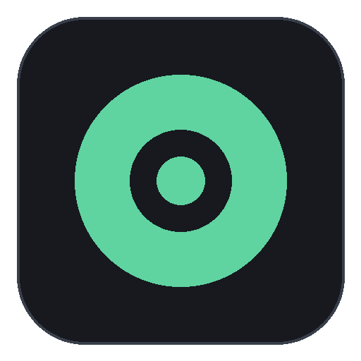

# Aceware



**Aceware**, a Geode mod for **Geometry Dash**. Click a hair too early and instead of dying, the
click waits for a tick where it actually survives, then goes through.

- **Windows**, Geometry Dash **2.2081**, Geode **5.11.2**
- Version **1.4.3**
- No network calls, no telemetry, no update checks.

## Install

1. Install [Geode](https://geode-sdk.org/install/) for Geometry Dash 2.2081.
2. Download `release/Aceware-1.4.3.geode`.
3. Drop it into `Geometry Dash/geode/mods/`, or drag it onto the game window.
4. Start the game and enable **Aceware** in the Geode mod list.

## Controls

| Key | Action |
|-----|--------|
| **Right Shift** | show / hide the window (or the round green button in the pause menu) |
| **F6** | cycle stage |
| **F7** | buffer on / off, remembers the stage you were on |
| drag title bar | move the window |
| drag bottom-right corner | resize the window |

## The window

Five tabs in the sidebar:

- **Log** — what happened to every click: time, tag, text. Scroll with the wheel or by dragging.
- **Stats** — prediction accuracy, your rhythm, window sizes, system.
- **Stage** — stage buttons, a line with every stage's frames as **cube / ship / wave**, options,
  Forget Level, and the Custom frames / min / max.
- **Modes** — one tile per gamemode; turn buffering on or off for each.
- **Assists** — orb helper, raw wave spam, hitboxes, show rays. A **Keys** card and a **Quick** card
  (Copy Report, Hide Window) sit on the right.

## Stages

Frames are 60fps frames (1 frame = 16.7 ms). Ticks are GD's physics steps (240 per second).

| Stage | Cube | Ship | Wave |
|-------|------|------|------|
| Off | raw input | raw input | raw input |
| Stage 1 | 1 | 1 | 1 |
| Stage 2 | 2 | 2 | 2 |
| Stage 3 | 3 | 2 | 3 |
| Stage 4 | 5 | 2 | 4 |
| Extreme (buggy) | 20 | 2 | 12 |
| Custom | yours | yours | yours |

## How it decides

- Every click is played forward on a hidden copy of the player: jumps, orbs, pads, portals, moving
  objects. The ghost steps one physics tick at a time, 240 times a second.
- Safe already? The click goes in untouched.
- Deadly? More ghosts are tested than a single one: every tick across the first frame after the
  earliest safe tick, then every second tick out to three frames. Each candidate must read **Good**,
  and the one with the most room around it wins. Equally good candidates are chosen at random.
- A **release** is never held past the moment you made it, needs only one proven tick, and on
  Extreme is hard-capped at 8 ticks — letting go can't leave the button down.
- Nothing survives? The click goes in exactly as you clicked it.

Decisions are made live. Nothing is remembered between attempts, and there is no level scan.

## Build from source

Requires the [Geode SDK](https://docs.geode-sdk.org/getting-started/) and CMake 3.21+.

```sh
export GEODE_SDK=/path/to/geode-sdk
cmake -B build
cmake --build build --config Release
```

The `.geode` lands in `build/`. `GEODE_SDK` must point at an installed Geode SDK for 5.11.2.

There is also `tools/local-build.ps1`, the offline build used to produce the release binary: it
expects a sibling `toolchain/` folder with the MSVC/SDK/bindings bundle, and is not needed if you
use CMake. A GitHub Actions workflow is included: push to `main` and it builds on
`windows-latest` and attaches the `.geode` to a release whose tag is the version in `mod.json`.

## Layout

```
src/main.cpp        engine, hooks, and the window
src/BufferCore.hpp  delay search, input queue, clearance, spot memory
src/AceCourse.hpp   course / trajectory helpers
src/AceTheme.hpp    shape and texture helpers the window draws with
src/OnlineURL.hpp   empty: this build has no server
src/ProjectDefs.hpp defines for the offline build script (CMake supplies its own)
mod.json            Geode manifest (id ace.aceware)
about.md            page text shown inside the mod
release/            the built, ready-to-install .geode
```

## Credits

Built and maintained by **Ace** (`ace.aceware`).

The bundled font (Poppins Bold) is under the SIL Open Font License, included at
`resources/fonts/OFL.txt`.
